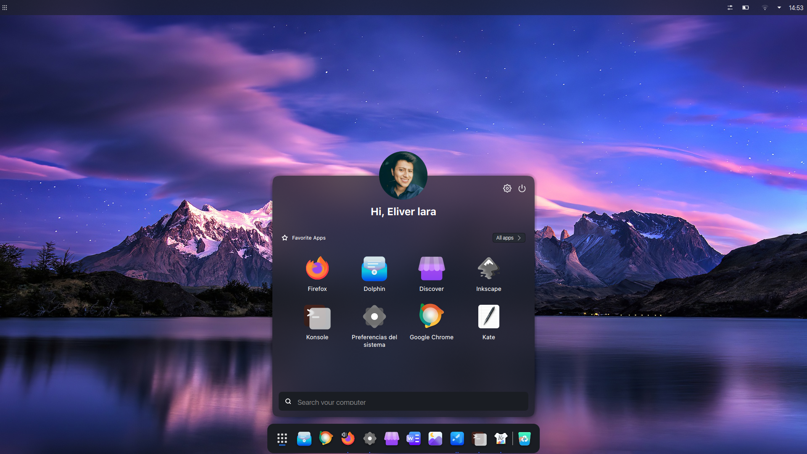
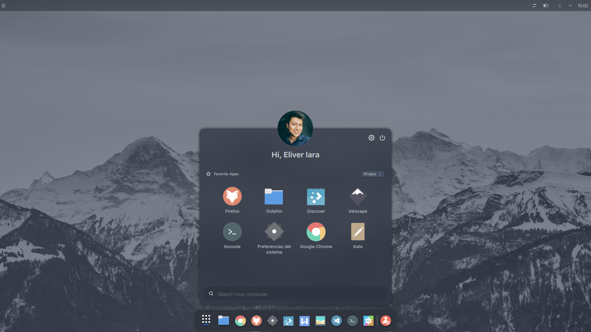

<div align="center">

# XLauncher

A simple Launcher for KDE Plasma 6, forked from [Andromeda Launcher](https://github.com/EliverLara/AndromedaLauncher) by EliverLara, which is based on the awesome [mmcklauncher](https://github.com/SnoutBug/mmcklauncher)




</div>

## Installation
```sh
git clone https://github.com/AxiomOperator/XLauncher.git
kpackagetool6 --type Plasma/Applet --install XLauncher
```

To update an existing install, run `git pull` and then `kpackagetool6 --type Plasma/Applet --upgrade XLauncher`.

XLauncher uses its own widget id, so it can be installed alongside Andromeda Launcher.

## Usage
1. Right click on the desktop.
2. Click "Add New Widgets"
3. Search for "XLauncher"
4. Drag and drop to your desired place.


## Internationalization

If you would like to contribute by adding translations for your language, please follow the instructions in the [Translations Readme](translate/ReadMe.md).

## Support the original author ♥
XLauncher builds on EliverLara's work on Andromeda Launcher. If you enjoy it, consider supporting them:
<br>

<a href="https://ko-fi.com/eliverlara"></a>
<a href="https://www.paypal.com/paypalme/EliverLara/"></a>